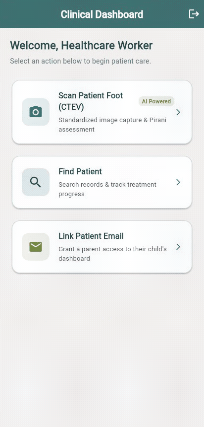
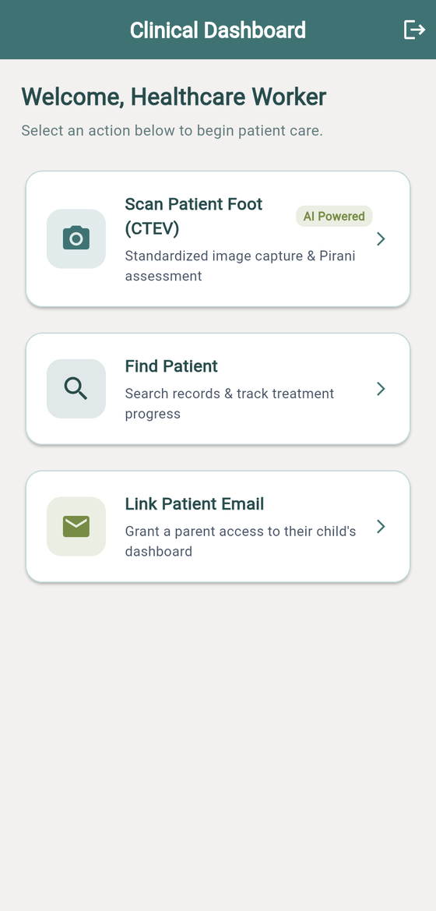
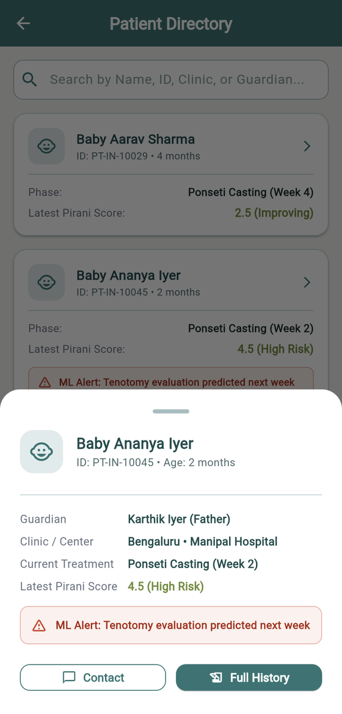
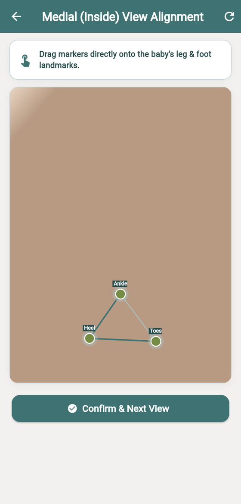
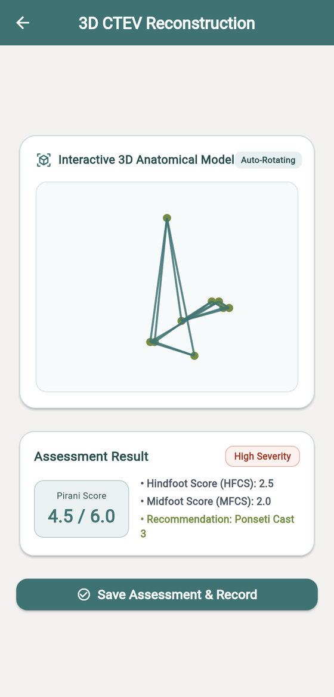
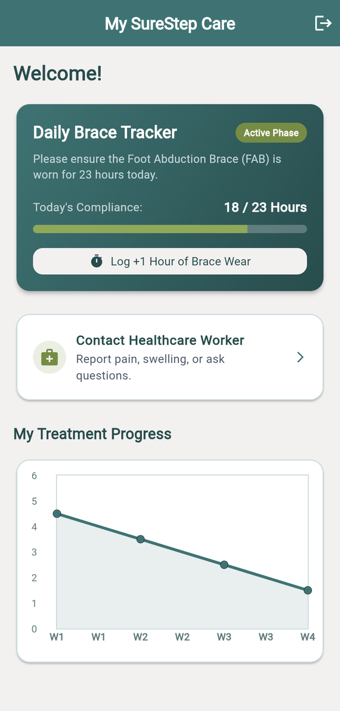

# SureStep: clubfoot screening and follow-up prototype

SureStep is a hackathon prototype for clubfoot (CTEV) care, aimed at health workers in rural clinics and at the parents of children in treatment. It is a Flutter app with two roles (health worker and parent) and a small Flask API for accounts. It was built by team TechSquad at Medithon.



*Recorded locally from the Flutter web build in headless Chromium, sped up about 1.6x. A plain colour placeholder image stands in for the foot photos, and the patient records are the sample data hardcoded in the app. Camera capture and ML Kit pose detection do not run on web, so this shows the upload path.*

## What is in the prototype

This is a front-end prototype: all screens work, but their data is hardcoded or kept in memory, and the app does not talk to the backend yet.

**Health worker** (log in with `nurse` / `nurse123`)
- **3-view scan**: guided capture of the medial, lateral and posterior views, from the camera or an uploaded image. Each view opens an alignment screen with draggable landmark markers (ankle, heel and toes, or calf, ankle and heel for the posterior view).
- **Assessment screen**: a short "reconstruction" animation, a rotating wireframe, and a Pirani score card, followed by a data-sharing consent dialog. The markers start at fixed positions on the image, and the score card always shows 4.5 / 6.0 (see "How it works").
- **Patient directory**: five sample patients with treatment phase, latest Pirani score and alerts, search, and a detail sheet.
- **Link patient email**: a dialog for inviting a parent (shows a confirmation only).

**Parent** (log in with `patient` / `patient123`)
- **Daily brace tracker**: logs hours of Foot Abduction Brace wear towards a 23-hour goal.
- **Contact the clinic**: a form for pain, swelling or brace problems with a photo button (shows a confirmation only).
- **Treatment progress**: a chart of Pirani scores over four weeks (sample values).

**Backend**: register, log in and fetch the current user, with bcrypt password hashes and HS256 JWTs. It uses SQLite unless `DATABASE_URL` points at Postgres.

| Health worker home | Patient record | Landmark alignment | Assessment | Parent home |
| --- | --- | --- | --- | --- |
|  |  |  |  |  |

*Flutter web build at a 412×860 phone-sized viewport, sample data only.*

## How it works

- `packages/frontend/lib/main.dart` loads `.env` and opens `LoginScreen`. Login is mocked in `features/auth/login_screen.dart`: the two prototype accounts route to `HealthcareWorkerDashboard` or `PatientDashboard`. The register screen shows a success message without calling the API.
- `features/scan/scan_flow_screen.dart` walks through the three views. On Android and iOS it starts the camera and creates an ML Kit `PoseDetector`, then runs it on each captured image. The detected poses are passed to `ImageAnalysisScreen` but not used yet: the markers are placed at fixed fractions of the image size per view, and the health worker drags them into place. On web the camera and detector are skipped and the capture button opens a file picker.
- `features/scan/mock_3d_model_screen.dart` animates a progress bar, draws a rotating wireframe from fixed points, and shows a fixed Pirani breakdown (hindfoot 2.5, midfoot 2.0, "Ponseti Cast 3"). The consent dialog shows "Record saved" either way; nothing is stored.
- `features/healthcare_worker/patient_list_screen.dart` holds the five sample patients in a `const` list.
- `core/api_client.dart` sets up a Dio client for the backend (`API_BASE_URL`), but no screen uses it.
- `packages/backend/app/` is a Flask app factory: `routes/auth_routes.py` (`/api/auth/register`, `/login`, `/me`), Pydantic request schemas, `require_auth` middleware, and JSON error handlers. Tables are created on startup with `db.create_all()`.
- `openapi.yaml` also describes planned sync and trajectory-prediction endpoints (`/patients/sync`, `/assessments/sync`, `/ml/predict-trajectory`). These are not implemented.

## Platforms and what was demoed

| Part | Status here |
| --- | --- |
| Flutter web (Chrome) | Built with `flutter build web` and driven with Playwright. All screens above come from this. |
| Android / iOS | Not run: no emulator or device was available. This is where the camera preview and ML Kit pose detection would run. |
| Linux desktop | Not configured in the repo (there is no `linux/` folder). |
| macOS desktop | A `macos/` runner exists; not tried (needs a Mac). |
| Flask backend | Run locally with SQLite; output below. |

## Tech stack

- App: Flutter (Dart 3), `camera`, `image_picker`, `permission_handler`, `google_mlkit_pose_detection`, `fl_chart`, `dio`, `shared_preferences`, `flutter_dotenv`
- API: Python 3.12, Flask 3, Flask-SQLAlchemy, Pydantic 2, PyJWT, bcrypt; SQLite by default, Postgres (Neon) via `DATABASE_URL`

## Run it locally

### Backend

```bash
cd packages/backend
cp .env.example .env      # optional; set DATABASE_URL, SECRET_KEY and JWT_SECRET for anything beyond local testing
uv venv --python 3.12 venv
source venv/bin/activate
uv pip install -r requirements.txt
python run.py             # http://127.0.0.1:5050 (PORT overrides it)
```

`./run.sh backend` from the repo root does the same. Without `DATABASE_URL` the app uses SQLite (`instance/app.db`), and without `JWT_SECRET` it signs tokens with a built-in default, so set one outside local testing.

Real requests against a local run (token shortened):

```text
$ curl -s -X POST http://127.0.0.1:5050/api/auth/register -H 'Content-Type: application/json' \
    -d '{"username":"demo_nurse","email":"nurse@example.com","password":"demo-pass-1","role":"healthcare_worker"}'
{
  "message": "User registered successfully",
  "user": {
    "created_at": "2026-11-15T14:42:06.730568",
    "email": "nurse@example.com",
    "id": 1,
    "role": "healthcare_worker",
    "username": "demo_nurse"
  }
}

$ curl -s -X POST http://127.0.0.1:5050/api/auth/login -H 'Content-Type: application/json' \
    -d '{"email":"nurse@example.com","password":"demo-pass-1"}'
{
  "message": "Login successful",
  "token": "eyJhbGciOiJIUzI1NiIs...",
  "user": { "email": "nurse@example.com", "id": 1, "role": "healthcare_worker", "username": "demo_nurse", ... }
}

$ curl -s http://127.0.0.1:5050/api/auth/me
{
  "error": "Unauthorized",
  "message": "Missing or invalid token"
}
```

With the token, `GET /api/auth/me` returns the same `user` object. Invalid input (short username or password, bad email, a role other than `healthcare_worker` or `patient`) returns 400 with the Pydantic error list.

### App

```bash
cd packages/frontend
cp .env.example .env      # required: the build bundles .env and fails without it
flutter pub get
flutter run -d chrome     # or a connected Android device for the camera and ML Kit path
```

`./run.sh frontend` serves the web build on port 3000 (`flutter run -d web-server --web-port=3000`). `./run.sh app` and `./run.sh desktop` also open a Chrome app window using the macOS `open` command, so they only work on a Mac.

For the demos here the web app was built with `flutter build web --release` and served from `build/web` with a static file server.

### Environment variables

Backend (`packages/backend/.env`):

| Name | Purpose |
| --- | --- |
| `DATABASE_URL` | Postgres URL (Neon in the original setup); SQLite if unset |
| `SECRET_KEY` | Flask secret key |
| `JWT_SECRET` | Key for signing login tokens |
| `JWT_EXPIRATION_HOURS` | Token lifetime (default 24) |
| `PORT` | Port for `python run.py` (default 5050) |
| `JWKS_URL`, `AUTH_URL` | Read into config, not used yet |

App (`packages/frontend/.env`):

| Name | Purpose |
| --- | --- |
| `API_BASE_URL` | Backend base URL for the Dio client (not called by any screen yet) |

There are no meaningful automated tests: `packages/frontend/test/widget_test.dart` is the Flutter template test.

## Known gaps

- Fresh clones need `packages/frontend/.env` (see `.env.example`): `pubspec.yaml` lists it as an asset and it is gitignored, so `flutter build web` fails without it. An empty `.env` builds but `flutter_dotenv` throws at startup and the app shows a blank screen.
- Port numbers disagree: `run.py` uses 5050, while `docker-compose.yml`, the backend `Dockerfile`, `openapi.yaml` and the app's fallback `API_BASE_URL` use 5000.
- The patient progress chart repeats its x-axis labels (W1, W1, W2, W2, ...) because the bottom axis has no interval set.

## Project structure

```text
packages/
  backend/
    run.py                      starts the Flask app (port 5050)
    app/__init__.py             app factory, creates tables
    app/routes/auth_routes.py   register, login, me
    app/models/user.py          User table
    app/schemas/auth_schema.py  request validation
    app/middlewares/            JWT check, JSON error handlers
  frontend/
    lib/main.dart               loads .env, opens the login screen
    lib/features/auth/          mocked login, register form
    lib/features/healthcare_worker/  dashboard, patient directory
    lib/features/scan/          3-view capture, landmark alignment, assessment screen
    lib/features/patient/       brace tracker, contact form, progress chart
    lib/core/                   theme ("Serenity" palette), Dio client
openapi.yaml                    API description, including planned endpoints
HOW_TO_RUN.md, SETUP.md         earlier run notes
run.sh                          ./run.sh backend | frontend | app | desktop
```

## Team

Built by team TechSquad at Medithon. From the git history:

- **[Abbas Nadir](https://github.com/abbasnadir)**: the monorepo setup and Flask backend (auth routes, JWT middleware, error handling, config), the Flutter app's first version including the 3-view scan flow with ML Kit, the mock 3D assessment screen, the patient and health worker dashboards, `openapi.yaml`, and the first `run.sh`.
- **Nidhi Dharme**: the SureStep branding and logo, the "Serenity" colour theme, the sample patient directory and detail sheet, a large rework of the scan and assessment screens (including the draggable landmark markers), the web and macOS runners, `HOW_TO_RUN.md`, and the `run.sh` app/desktop modes.

Other team members did not commit to this repository, so they are not listed here.

There is no license file in this repo.
